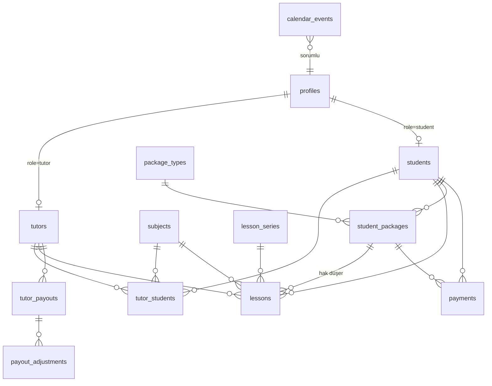

# 04 · Veritabanı Şeması (Supabase / PostgreSQL)

## 1. İlişki diyagramı



## 2. Tablolar

### Kimlik
**profiles** — `auth.users` ile 1-1
| Kolon | Tip | Not |
|---|---|---|
| id | uuid PK → auth.users | |
| role | enum `user_role` (`founder`,`tutor`,`student`) | |
| full_name | text | |
| phone | text | |
| avatar_url | text null | |
| is_active | bool default true | Pasif kullanıcı giriş yapamaz |
| created_at / updated_at | timestamptz | |

**tutors**
| Kolon | Tip | Not |
|---|---|---|
| id | uuid PK → profiles | |
| university, department | text | |
| yks_rank | int null | "Türkiye 382." |
| bio | text null | |
| services | text[] | `ozel_ders`, `kocluk` |
| default_meeting_url | text null | Kişisel Zoom/Meet odası |
| rate_private | numeric(10,2) | Özel ders başı eğitmen ücreti |
| rate_coaching | numeric(10,2) | Koçluk başı eğitmen ücreti |
| iban | text null | Sadece kurucu + kendisi görür |

**tutor_subjects** (tutor_id, subject_id) — eğitmenin verebildiği branşlar

**students**
| Kolon | Tip | Not |
|---|---|---|
| id | uuid PK → profiles | |
| grade | smallint (1–12, 13 = mezun) | |
| goal | enum `student_goal` (`yks`,`lgs`,`okul`,`genel`) | |
| school | text null | |
| guardian_name, guardian_phone | text null | Veli |
| founder_notes | text null | Sadece kurucular |

**subjects** — id, name, color, sort_order, is_active

**tutor_students** — eşleştirme
| id, tutor_id, student_id, subject_id, service (`ozel_ders`/`kocluk`), is_active, assigned_at, assigned_by |
Unique: (tutor_id, student_id, subject_id) aktifken.

### Dersler
**lesson_series** — tekrarlayan plan
| id, tutor_id, student_id, subject_id, lesson_type, weekday (1–7), start_time (time), duration_min, starts_on, ends_on, is_active |

**lessons**
| Kolon | Tip | Not |
|---|---|---|
| id | uuid PK | |
| series_id | uuid null → lesson_series | |
| tutor_id, student_id, subject_id | uuid | |
| lesson_type | enum (`ozel_ders`,`kocluk`) | |
| starts_at, ends_at | timestamptz | |
| status | enum `lesson_status`: `planned`, `completed`, `no_show`, `cancelled_by_student`, `cancelled_by_tutor`, `postponed` | |
| meeting_url | text null | |
| student_package_id | uuid null | Hakkın düştüğü paket |
| is_free | bool default false | Hediye koçluk |
| tutor_rate_snapshot | numeric(10,2) | Ders oluşturulurken kopyalanır |
| topic | text null | İşlenen konu |
| homework | text null | |
| homework_done | bool default false | Öğrenci işaretler |
| performance | smallint null (1–5) | |
| note_for_student | text null | Öğrenci/veli görür |
| note_private | text null | Sadece eğitmen + kurucu |
| postponed_to | uuid null → lessons | Ertelemede yeni ders |
| created_by | uuid | |
| completed_at | timestamptz null | |

Kısıtlar:
```sql
alter table lessons add constraint no_tutor_overlap
  exclude using gist (tutor_id with =, tstzrange(starts_at, ends_at) with &&)
  where (status = 'planned');
alter table lessons add constraint no_student_overlap
  exclude using gist (student_id with =, tstzrange(starts_at, ends_at) with &&)
  where (status = 'planned');
```
İndeksler: (tutor_id, starts_at), (student_id, starts_at), (status, starts_at).

### Finans
**package_types** — id, name ("Haftada 2 Ders"), lesson_type, lesson_count (8), unit_price (850), total_price (6800), includes_free_coaching (bool), is_active
Seed: Tek Ders 950×1, Haftada 2 850×8=6.800, Haftada 3 800×12=9.600, Koçluk (fiyat kurucu girer).

**student_packages**
| id, student_id, package_type_id null, name, lesson_count, used_count (trigger ile), price_total, discount, starts_on, ends_on null, status (`active`,`completed`,`cancelled`), notes |
`remaining = lesson_count - used_count` (generated column).

**payments** (öğrenciden tahsilat)
| id, student_id, student_package_id null, amount, paid_at (date), method (`havale`,`nakit`,`kart`,`diger`), note, recorded_by |

**tutor_payouts** (eğitmene ödeme dönemi)
| id, tutor_id, period (date — ayın 1'i), lesson_total (hesaplanan), adjustment_total, amount_paid, paid_at null, status (`open`,`paid`), note |
Unique: (tutor_id, period).

**payout_adjustments** — id, payout_id, amount (+/−), reason

### Akademik & içerik takvimi
**calendar_events**
| Kolon | Tip | Not |
|---|---|---|
| id | uuid | |
| category | enum: `exam`, `school`, `holiday`, `content`, `campaign`, `other` | |
| content_type | enum null: `tanitim`, `viral`, `egitmen_tanitimi`, `egitici`, `motivasyon`, `kampanya` | category=content ise |
| content_status | enum null: `fikir`, `senaryo`, `cekildi`, `kurgu`, `hazir`, `yayinlandi` | |
| platforms | text[] | instagram, tiktok, youtube |
| title | text | |
| description | text null | Senaryo / not |
| starts_at, ends_at | timestamptz | |
| all_day | bool | |
| is_tentative | bool | "Tahmini" (YKS/LGS) |
| visible_to_students | bool default false | Öğrenci takviminde görünsün |
| exam_kind | text null | `yks`,`lgs`,`yazili`,`deneme` → geri sayım için |
| assignee_id | uuid null → profiles (founder) | |
| published_url | text null | |
| color | text null | |

### Sistem
**audit_log** — id, actor_id, action, entity, entity_id, diff jsonb, created_at (trigger ile: lessons durum, payments, payouts, student_packages)

## 3. Trigger / fonksiyonlar
- `handle_new_user()` — auth.users insert → profiles satırı (rol, davetteki metadata'dan)
- `custom_access_token_hook()` — JWT'ye `user_role` claim ekler
- `apply_lesson_credit()` — lessons.status değişince ilgili `student_packages.used_count` güncellenir (aktif ve hakkı olan en eski paket otomatik seçilir)
- `set_tutor_rate_snapshot()` — lesson insert'te eğitmen ücretini kopyalar
- `compute_payout(tutor_id, period)` — RPC; dönem toplamını hesaplar
- `guard_locked_period()` — ödenmiş dönemdeki dersin eğitmen tarafından değiştirilmesini engeller

## 4. Row Level Security özeti

Yardımcı fonksiyonlar: `auth_role()` (JWT claim), `is_founder()`, `auth.uid()`.

| Tablo | founder | tutor | student |
|---|---|---|---|
| profiles | tümü R/W | kendisi + atanmış öğrencileri (R) | kendisi + eğitmenleri (R, sınırlı kolon) |
| tutors | tümü R/W | kendisi R/W (ücret, IBAN hariç W) | eğitmenleri R (public kolonlar — view) |
| students | tümü R/W | atanmış öğrencileri R (founder_notes hariç — view) | kendisi R |
| tutor_students | R/W | kendi satırları R | kendi satırları R |
| lessons | R/W | kendi dersleri R/W; insert yalnızca atanmış öğrenciye; `note_private` | kendi dersleri R; yalnızca `homework_done` W |
| lesson_series | R/W | kendi R/W | — |
| package_types | R/W | — | R |
| student_packages | R/W | atanmış öğrencinin kalan hakkı (view, tutar yok) | kendisi R |
| payments | R/W | — | kendisi R |
| tutor_payouts / adjustments | R/W | kendisi R | — |
| calendar_events | R/W | `visible_to_students` R | `visible_to_students` R |
| audit_log | R | — | — |

Hassas kolonlar (ücret, IBAN, kurucu notları, `note_private`) için ayrı **view**'lar (`tutor_public`, `student_for_tutor`, `lesson_for_student`) kullanılır; RLS satırı, view kolonları sınırlar.

## 5. Migration sırası
1. `0001_enums_and_profiles.sql`
2. `0002_tutors_students_subjects.sql`
3. `0003_lessons.sql` (+ btree_gist extension, exclusion constraints)
4. `0004_finance.sql`
5. `0005_calendar_events.sql`
6. `0006_rls_policies.sql`
7. `0007_triggers_functions.sql`
8. `seed.sql`
